# Key Framework & Architecture Figures

> 自动生成的关键框架图/方法流程图集合。删除不需要的图后，再次运行不会重复添加。
> 每篇论文选取 1-2 张核心框架图，基于 caption 关键词、图片类型和尺寸三层评分筛选。

---

## 2008-ICC-Detection_of_Encrypted_Tunnels_Across_Network_Boundaries

**Fig. 1** — Fig. 1. How tunnels work: high-level scheme.
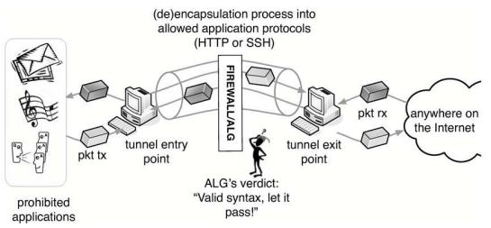

---

## 2017-TIFS-Classification_of_Encrypted_Traffic_With_Second-Order_Markov_Chains_and_Application_Attribute_Bigrams

**Fig. 4** — Fig. 4. System Overview.
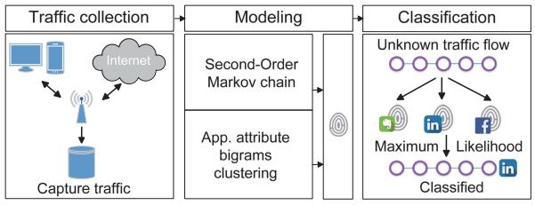

---

## 2018-CCS-Deep_Fingerprinting_Undermining_Website_Fingerprinting_Defenses_with_Deep_Learning

**Figure 2** — A basic architecture of convolutional neural networks (CNN)
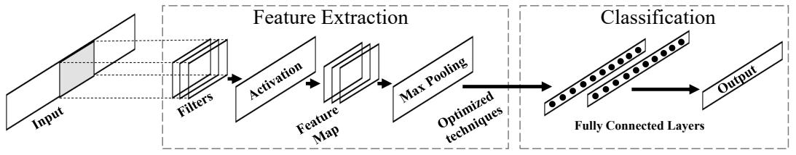

---

## 2018-CS-An_Efficient_Feature_Generation_Approach_Based_on_Deep_Learning_and_Feature_Selection_Techniques_for_Traffic_Classification

**Fig. 4** — Fig. 4. The deep architecture of RFGM.
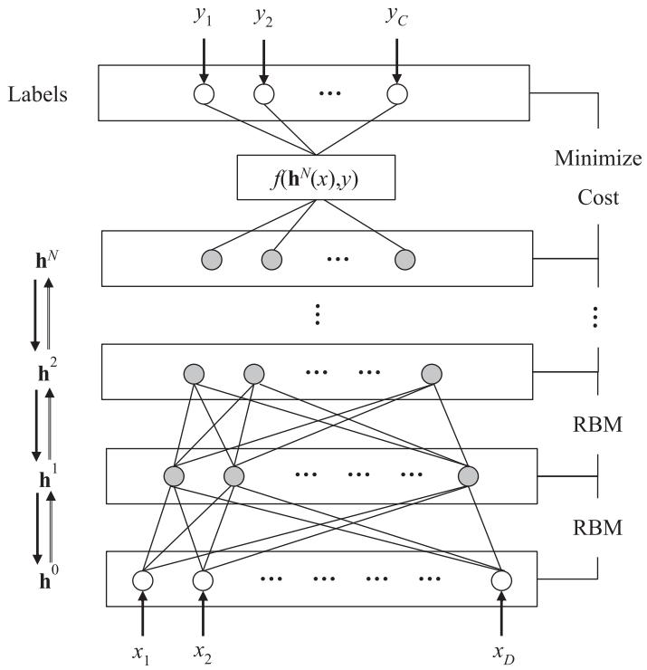

**Fig. 2** — Fig. 2. Overview of ML based traffic classification system.
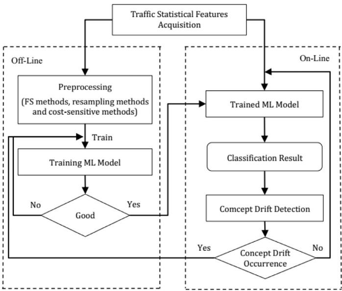

---

## 2018-Trans_IFS-Robust_Smartphone_App_Identification_via_Encrypted_Network_Traffic_Analysis

**Fig. 1** — Fig. 1. High-level representation of classifier training, and a visualisation of bursts and flows within network traffic. (a) Equipment setup. (b) Network trace capture. (c) Traffic burstification. (d) Flow separation. (e) Ambiguity detection. (f) Classifier training. (g) Trained classifiers.
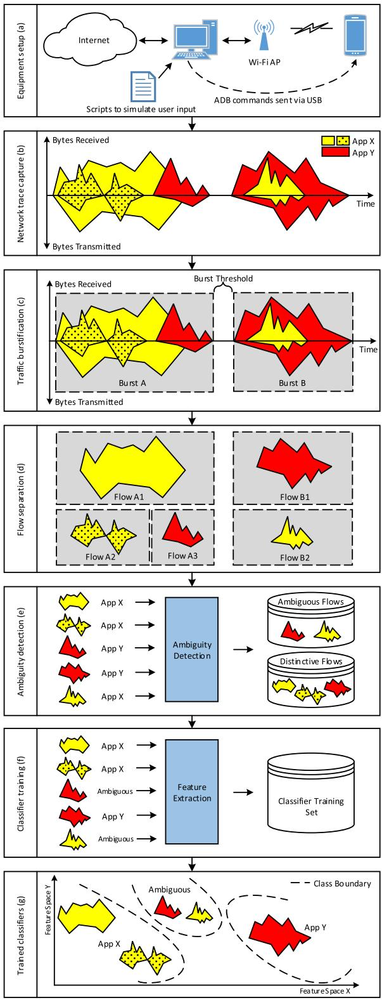

**Fig. 2** — Fig. 2. Generating features from flows for classifier training.
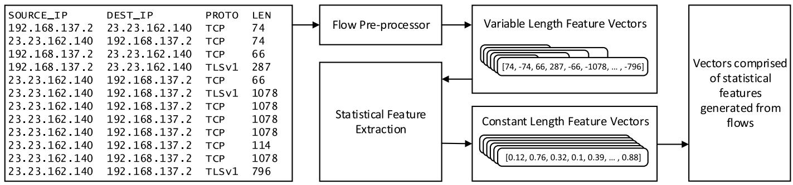

---

## 2019-INFOCOM-FS-Net__A_Flow_Sequence_Network_For_Encrypted_Traffic_Classification

**Fig. 2** — Fig. 2. The system overview of the FS-Net.
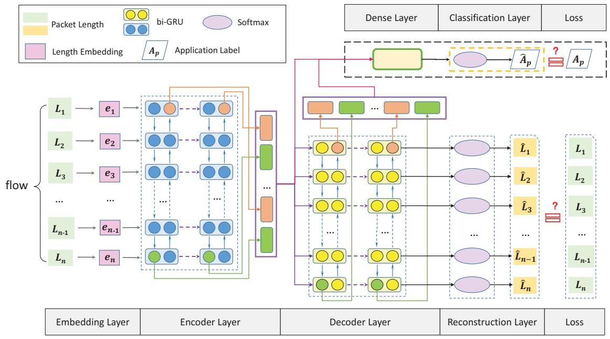

**Figure** — (b)  Fig. 1. 1(a) shows the architecture of gated recurrent unit, and 1(b) shows the basic structure of autoencoder.
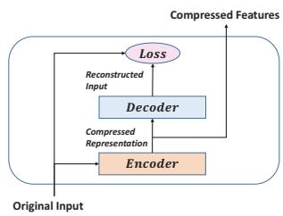

---

## 2019-INFOCOM-FlowPic__Encrypted_Internet_Traffic_Classification_is_as_Easy_as_Image_Recognition

**Figure 3** — An illustration of the architecture of our LeNet-5 style CNN.
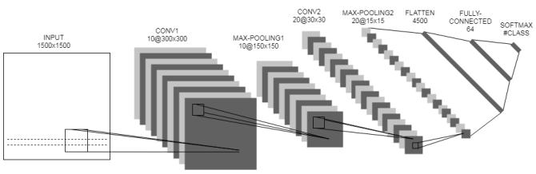

---

## 2020-CCS-Censored_Planet__An_Internet-wide__Longitudinal_Censorship_Observatory

**Figure 1** — Censored Planet Design.
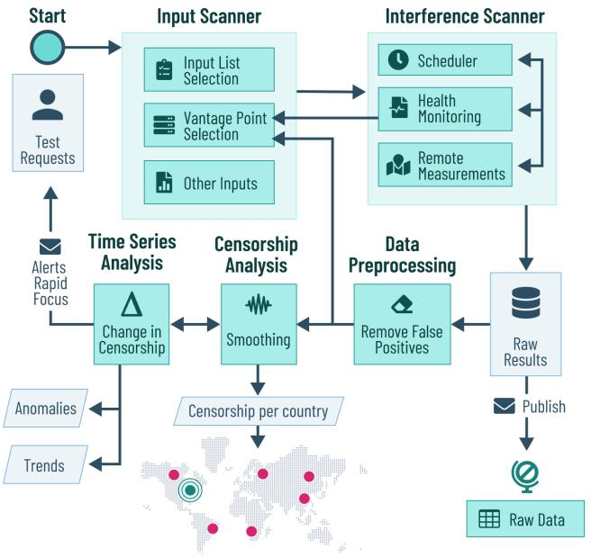

---

## 2020-CCS-TrafficSliver__Fighting_Website_Fingerprinting_Attacks_with_Traffic_Splitting

**Figure 1** — Design overview of our network-layer defense.
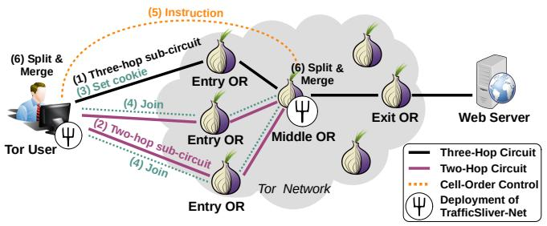

---

## 2020-IMC-How_China_Detects_and_Blocks_Shadowsocks

**Figure 1** — How active probing works. A genuine Shadowsocks client connects to a Shadowsocks server; Once the GFW passively determines that the connection may be Shadowsocks, it directs its active probers to confirm this guess.
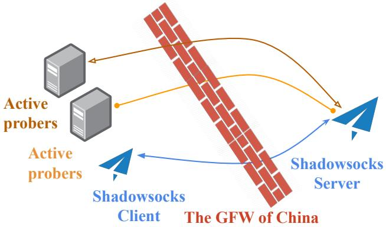

---

## 2020-NDSS-Detecting_Probe-resistant_Proxies

**Fig. 15** — Automated Decision Tree — We trained a multi-class decision tree classifier on the 25k endpoints in our Tap dataset (and 1k synthetically-generated proxy samples). Each node contains an array of the number of samples yet to be classified at that point in the tree: [not proxy, lampshade, mtproto, obfs4, ossh, shadowsocks-python]. Nodes are labeled with the current classification, and colored according to how confident a decision could be made at that point.
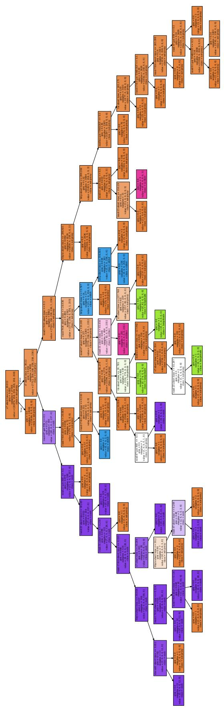

---

## 2020-NDSS-Flowprint__Semi-Supervised_Mobile-App_Fingerprinting_on_Encrypted_Network_Traffic

**Fig. 1** — Fig. 1. Overview of the creation and matching of app fingerprints. (A) We extract features from the network traces. (B) We cluster the flows from each device per network destination. (C) We detect and isolate browsers. (D) We discover correlations between network destinations. (E) We create fingerprints based on strong correlations. (F) We match newly found fingerprints against previously generated fingerprints and update them accordingly.
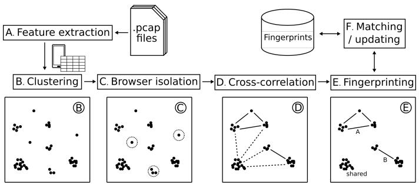

---

## 2020-TIFS-Fine-Grained_Webpage_Fingerprinting_Using_Only_Packet_Length_Information_of_Encrypted_Traffic

**Fig. 2** — Fig. 2. Overview of FineWP.
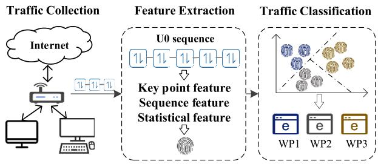

---

## 2020-USENIX-Zero-delay_Lightweight_Defenses_against_Website_Fingerprinting

**Figure 1** — The threat model for WF. The adversary sits between the user and the Tor network. The middle node of Tor network will be a cooperating proxy to deploy our defense.
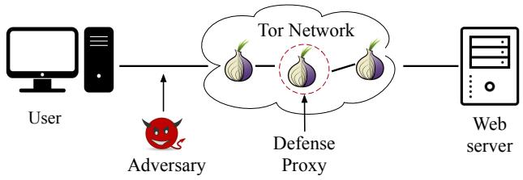

**Figure 8** — Client’s state machine. Starting from Front Mode, it will switch between Glue Mode and Back Mode until dwell time becomes too long. “Glue traces” are padded in Glue Mode. The client keeps sampling inter-arrival times in both Front and Back Mode.
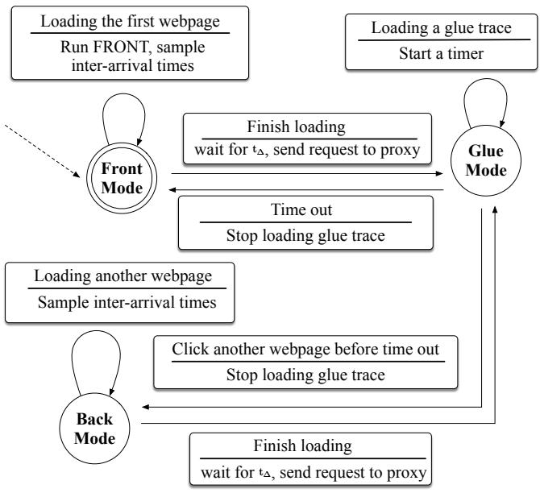

---

## 2021-CCS-Realtime_Robust_Malicious_Traffic_Detection_via_Frequency_Domain_Analysis

**Figure 1** — High-level design of Whisper.
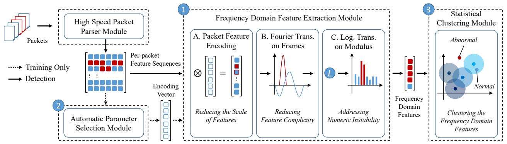

---

## 2021-NDSS-Detecting_Tor_Bridge_from_Sampled_Traffic_in_Backbone_Networks

**Fig. 4** — The architecture of the detection method
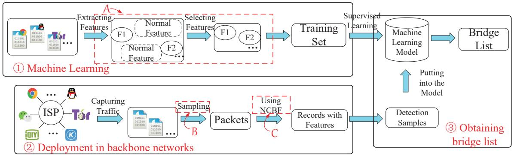

**Fig. 2** — Tor network architecture with bridge
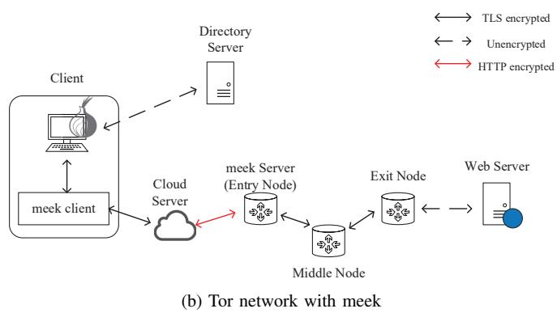

---

## 2021-TDSC-BiMorphing_A_Bi-Directional_Bursting_Defense_against_Website_Fingerprinting_Attacks

**Fig. 5** — Fig. 5. BIMORPHING architecture.
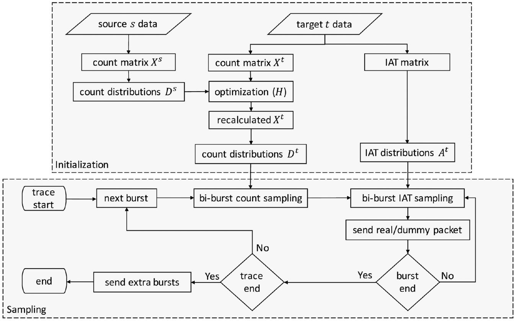

**Fig. 1** — Fig. 1. A Tor anonymity network example showing a user connecting to the Internet via three Tor nodes. The website fingerprinting passive attack occurs between the user and the Tor entry guard.
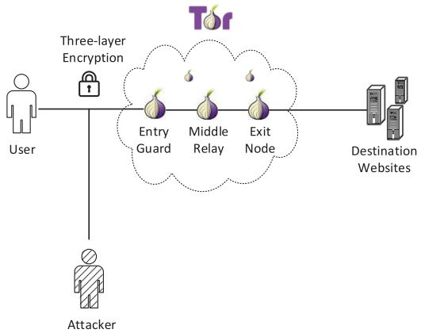

---

## 2021-TIFS-Accurate_Decentralized_Application_Identification_via_Encrypted_Traffic_Analysis_Using_Graph_Neural_Networks

**Fig. 5** — Fig. 5. Structure of Neural Networks in GraphDApp.
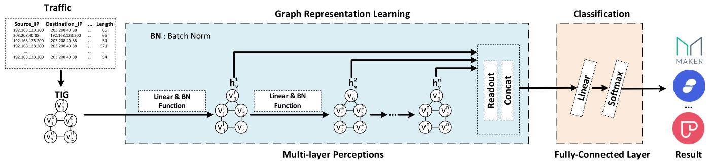

**Fig. 1** — Fig. 1. Typical Workflow of DApps on Ethereum.
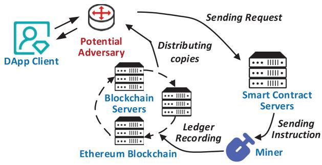

---

## 2021-USENIX-Defeating_DNN-Based_Traffic_Analysis_Systems_in_Real-Time_With_Blind_Adversarial_Perturbations

**Figure 3** — Overview of our BLANKET Tor pluggable transport, which applies blind adversarial perturbations on live Tor connections (the figure only shows the client-to-bridge operations; bridge-to-client operations work similarly).
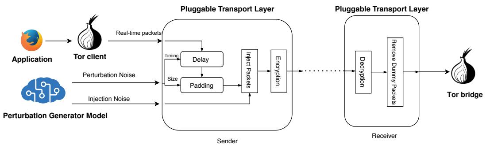

**Figure 2** — The block diagram of our blind adversarial perturbation technique
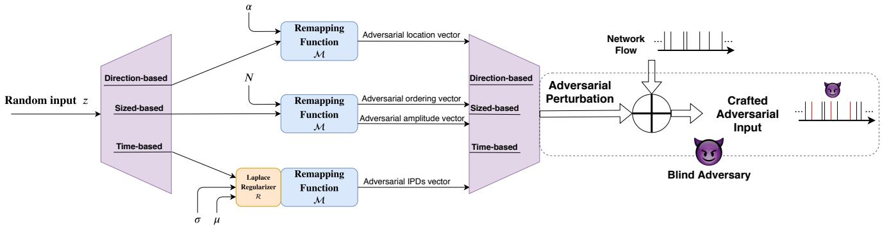

---

## 2021-USENIX-LZR__Identifying_Unexpected_Internet_Services

**Figure 12** — LZR Algorithm — LZR efficiently identifies real Internet services by sending application-layer data with the ACK of a TCP handshake to filter out non-acknowledging hosts and fingerprint the responding protocol.
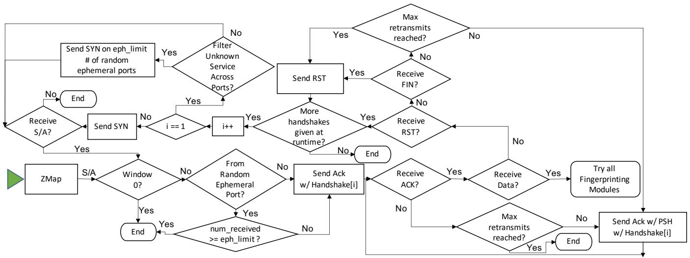

---

## 2022-COMST-Machine_Learning-Powered_Encrypted_Network_Traffic_Analysis_A_Comprehensive_Survey

**Fig. 4** — Fig. 4. A general workflow of encrypted traffic analysis.
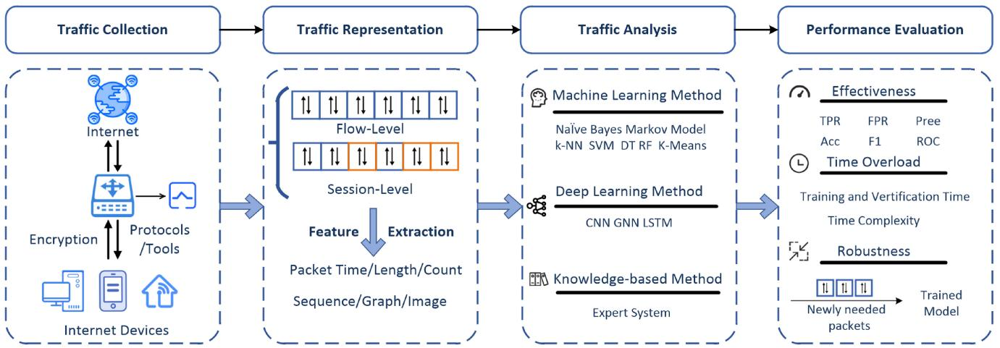

**Fig. 5** — Fig. 5. Mechanisms in the network model.
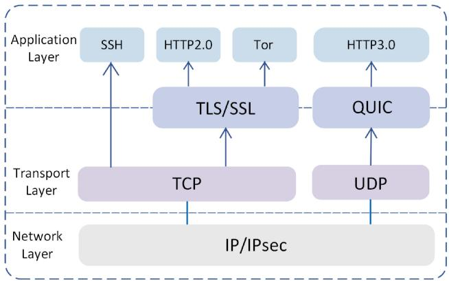

---

## 2022-EITCE-An_Encrypted_Traffic_Classification_Model_Based_on_the_Raw_Traffic_and_Spationtemporal_Characteristics

**Figure 1** — Framework of encrypted traffic classification model based on raw traffic and its spatiotemporal characteristics
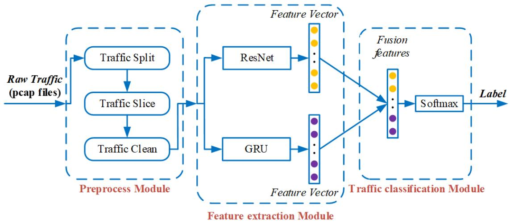

**Figure 2** — Data pre-processing steps
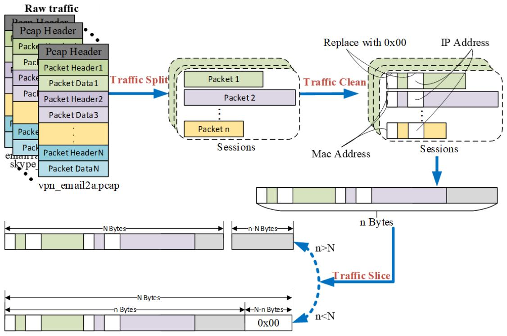

---

## 2022-HPCC-MTBD_HTTPS_Tunnel_Detection_Based_on_Multi-dimension_Traffic_Behaviors_Decision

**Fig. 2** — Fig. 2. The Framework of MTBD
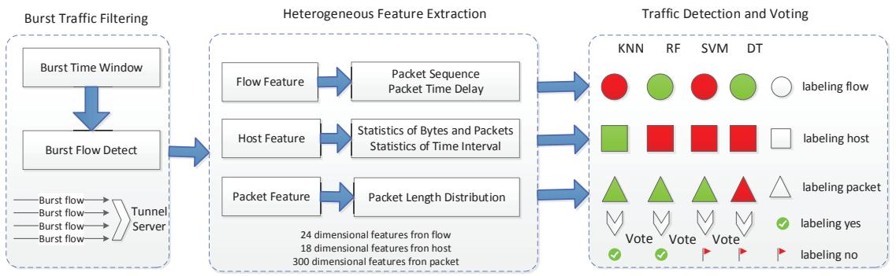

---

## 2022-ICMLA-Separating_Flows_in_Encrypted_Tunnel_Traffic

**Fig. 2** — Fig. 2. The architecture of our deep learning model.
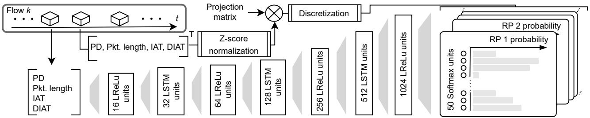

---

## 2022-S&P-Surakav__Generating_Realistic_Traces_for_a_Strong_Website_Fingerprinting_Defense

**Fig. 11** — The architecture of our generator and discriminator. (FC: fully-connected layer, BN: batch normalization, c: class label, \`: trace length, z:sampled noise vector.)
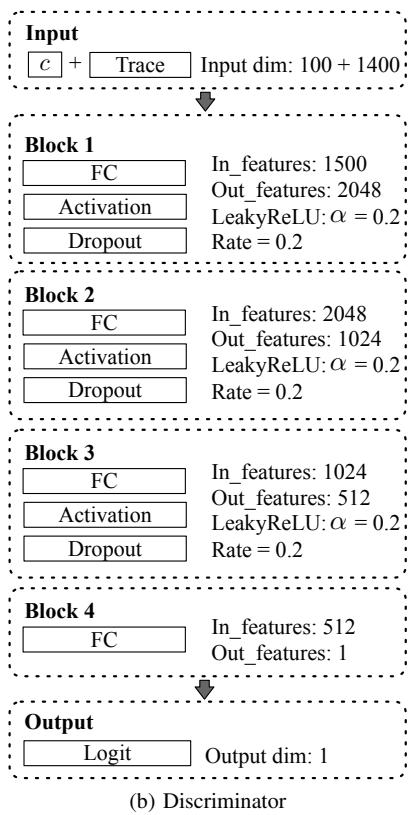

**Fig. 4** — The architecture of the Generator and the Discriminator. (FC: fully-connected layer, BN: batch normalization, c: class label, \`: trace length, z: sampled noise vector.)
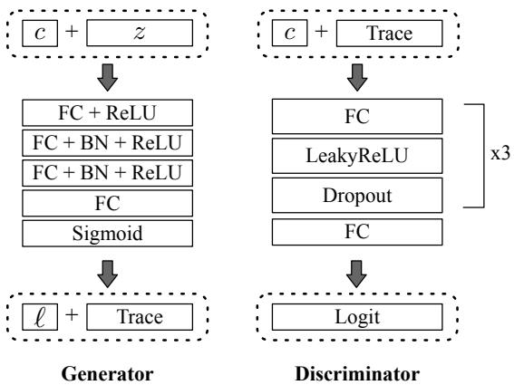

---

## 2022-TBD-Identification_of_Encrypted_Traffic_Through_Attention_Mechanism_Based_Long_Short_Term_Memory

**Fig. 6** — Fig. 6. The architecture diagram of HAN model.
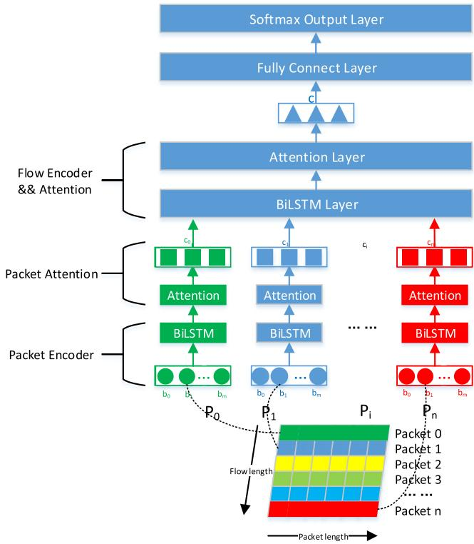

**Fig. 5** — Fig. 5. The architecture diagram of the attention based LSTM model.
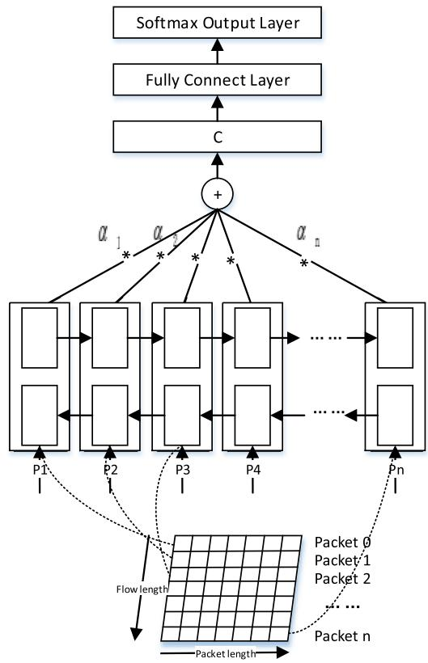

---

## 2022-TDSC-An_Automated_Multi-Tab_Website_Fingerprinting_Attack

**Fig. 2** — Fig. 2. The overview of our multi-tab website fingerprinting attack.
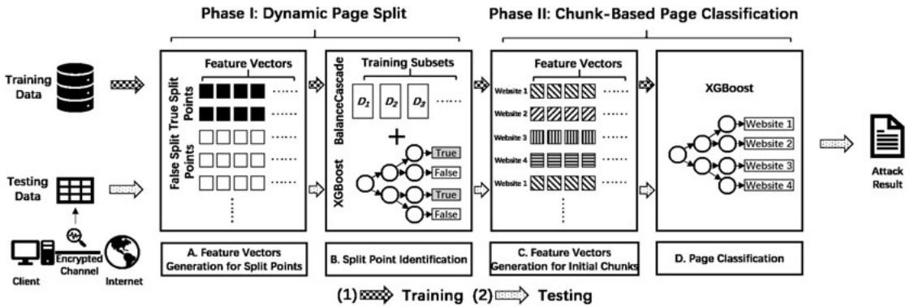

**Fig. 1** — Fig. 1. The illustration of the sequential multi-tab web browsing. The grey circles are the initial chunk of network packets solely generated for the first page. Other circles are network packets generated for different pages when at least two pages are loading simultaneously.
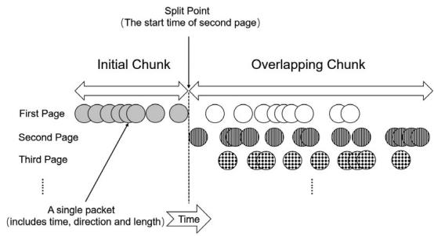

---

## 2022-TIFS-Minipatch__Undermining_DNN-Based_Website_Fingerprinting_With_Adversarial_Patches

**Fig. 3** — Fig. 3. Illustration of the Minipatch perturbation and how the adversarial patches are injected into website traces.
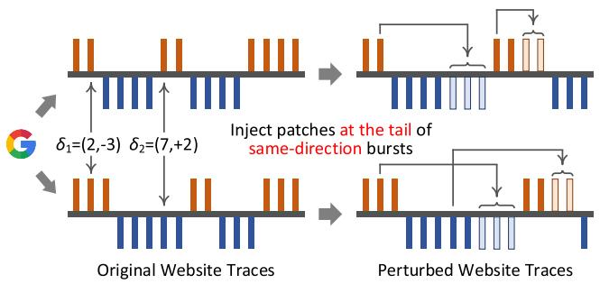

**Fig. 4** — Fig. 4. Illustration of adaptive bound tuning with $M _ { \alpha } = 2 , M _ { \beta } = 8$ . The process is based on the success rate (SR) and efficiency (EFF), with a success threshold $\tau = 0 . 9$ .
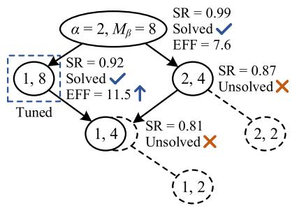

---

## 2022-USENIX-Online_Website_Fingerprinting__Evaluating_Website_Fingerprinting_Attacks_on_Tor_in_the_Real_World

**Figure** — (a) We train a feature extractor model using triplet networks to recognize the features that are best able to distinguish traffic patterns from different websites, following an approach from previous work [40].
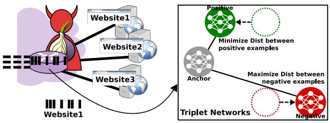

**Figure** — (a) Training Phase  (b) Deployment Phase  Figure 1: The traditional WF adversary model. (a) The adversary uses an automated browser (e.g., Selenium [47]) to collect a series of traffic traces via the Tor network for each website in the monitored set, and uses the labeled traces to train a machine learning prediction model. (b) The adversary observes unlabeled user traffic traces and uses the trained model to predict the label (i.e., the visited website). The observations can be made at any point between the client and entry that the adversary controls (e.g., wifi or cellular access point, internet routers or exchange points, or the Tor entry relay itself).

---

## 2022-USENIX-off-path_network_traffic_manipulation_via_revitalized_ICMP_redirect_attacks

**Figure 6** — Overview of DoS attacks.
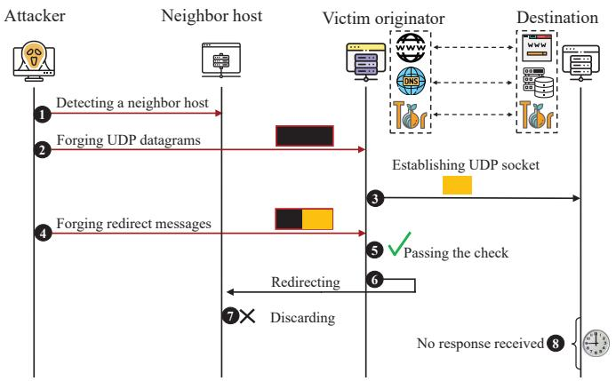

**Figure 10** — Off-path DNS requests hijacking in NAT networks.
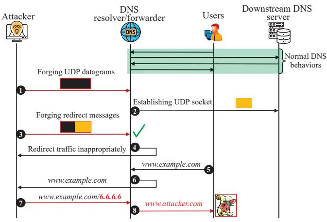

---

## 2022-WWW-ET-BERT__A_Contextualized_Datagram_Representation_with_Pre-training_Transformers_for_Encrypted_Traffic_Classification

**Figure 2** — Overview of ET-BERT Framework.
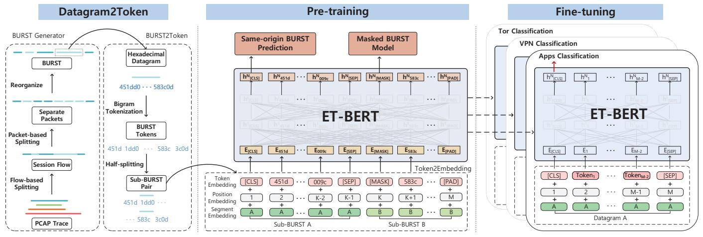

---

## 2023-AAAI-Yet_Another_Traffic_Classifier_a_Masked_Autoencoder_Based_Traffic_Transformer_With_Multi-level_Flow_Representation

**Figure 2** — The schematic illustration of YaTC.
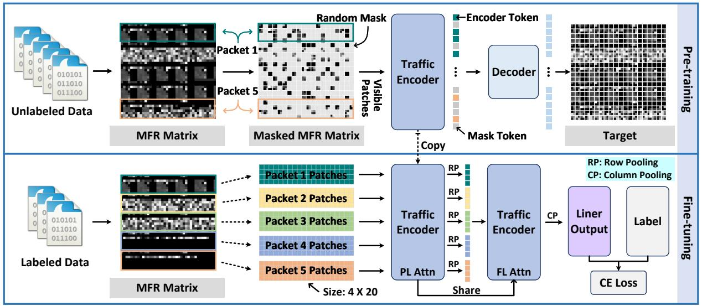

**Figure 1** — The schematic illustration of multi-level fow representation (MFR).
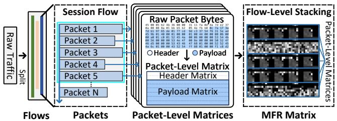

---

## 2023-CCS-Point_cloud_analysis_for_ML-based_malicious_traffic_detection_Reducing_majorities_of_false_positive_alarms

**Figure 3** — The overview of pVoxel.
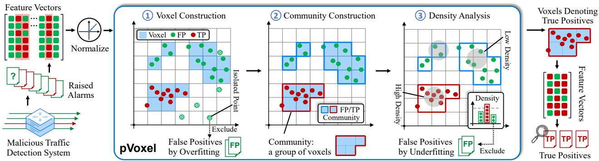

---

## 2023-CCS-Realistic_Website_Fingerprinting_by_Augmenting_Network_Traces

**Figure 2** — Overview of NetAugment
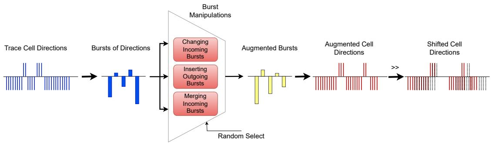

---

## 2023-CCS-Transformer-based_Model_for_Multi-tab_Website_Fingerprinting_Attack

**Figure 3** — Workflow of TMWF configured with $N = 4 .$

**Figure 4** — An ideal illustration of a real multi-tab trace.

---

## 2023-ComputerNetworks-Few-shot_encrypted_traffic_classification_via_multi-task_representation_enhanced_meta-learning

**Fig. 1** — Fig. 1. The whole architecture of the MetaMRE model.

---

## 2023-NDSS-Detecting_unknown_encrypted_malicious_traffic_in_real_time_via_flow_interaction_graph_analysis

**Fig. 1** — Fig. 1. The overview of HyperVision.

---

## 2023-S&P-Robust_Multi-tab_Website_Fingerprinting_Attacks_in_the_Wild

**Fig. 2** — The overview of our generic robust WF attack ARES. ARES is based on multi-tab WF architecture with multiple Trans-WF, and each Trans-WF identifies a specific website. Trans-WF consists of three module: traffic division module, local profiling module and website identification module.

**Fig. 4** — The multi-head top-m attention method correlates local traffic patterns for website fingerprinting even in the presence of noise interference. Different from the full connection of the original Transformer, Trans-WF keeps only the top-m attention.

---

## 2023-S&P-SoK__A_Critical_Evaluation_of_Efficient_Website_Fingerprinting_Defenses

**Figure** — A. Attack Model Fig. 1: Website Fingerprinting Attack Model.

---

## 2023-SIGCOMM-GGFAST__Automating_Generation_of_Flexible_Network_Traffic_Classifiers

**Figure 1** — GGFAST framework diagram

---

## 2023-SIGKDD-A_lightweight__efficient_and_explainable__by__design_convolutional_neural_network_for_internet_traffic_classification

**Figure 3** — The prototype block of ProtoPNet and the new Lightweight Prototype Layer of LEXNet (LProto) with its contributions in red. Sim. M. - similarity matrix.

**Figure 2** — ResNet original residual block (Res) and our new Lightweight and Efficient Residual block (LERes) with its contributions in red.

---

## 2023-TIFS-Exploring_Uncharted_Waters_of_Website_Fingerprinting

**Fig. 3** — Fig. 3. Overview of the research. We collect five datasets representing five distinct scenarios and evaluate them using seven WF techniques, including two novel techniques and five state-of-the-art techniques.

**Fig. 7** — Fig. 7. GFGC model architecture.

---

## 2023-TNET-Frequency_Domain_Feature_Based_Robust_Malicious_Traffic_Detection

**Fig. 1** — Fig. 1. High-level design of Whisper.

---

## 2023-TON-A_Novel_Multimodal_Deep_Learning_Framework_for_Encrypted_Traffic_Classification

**Fig. 2** — Fig. 2. The framework of the proposed multimodal end-to-end attentive network which includes five components.

**Fig. 3** — Fig. 3. The working principle of Packet Transfomer Encoder (PTE).

---

## 2023-TON-A_Two-Phase_Approach_to_Fast_and_Accurate_Classification_of_Encrypted_Traffic

**Fig. 1** — Fig. 1. Architecture of TaTic. (i) Training Module and (ii) Classification Module.

**Fig. 2** — Fig. 2. Overview of short-sequence trainer.

---

## 2023-USENIX-How_the_Great_Firewall_of_China_Detects_and_Blocks_Fully_Encrypted_Traffic

**Figure** — (e) Protocol exemption (Ex5): the GFW exempts a connection if its first few bytes match HTTP or TLS protocol. Figure 1: Examples of GFW’s traffic exemption rules — The GFW exempts a TCP connection if the payload of its first data packet matches any of the rules above. Traffic not exempted by any of the rules will be blocked. Printable characters refer to any character in range [0x20,0x7e]. Figures 1(a) , 1(b) , and 1(c) are introduced in Section 4.2. Figure 1(e) is introduced in Section 4.3. Figure 1(d) is introduced in Section 4.1.

---

## 2023-USENIX-Subverting_Website_Fingerprinting_Defenses_with_Robust_Traffic_Representation

**Figure 7** — The detail RF model’s architecture

---

## 2024-CCS-Detecting_tunneled_flooding_traffic_via_deep_semantic_analysis_of_packet_length_patterns

**Figure 5** — High-level architecture of Exosphere.

**Figure 8** — Architecture of the semicircular DNN model $\left( D = 3 \right)$ .

---

## 2024-CCS-Robust_and_reliable_early-stage_website_fingerprinting_attacks_via_spatial-temporal_distribution_analysis

**Figure 5** — The overview of Holmes.

**Figure 7** — The Encoder of Holmes.

---

## 2024-CCS-Towards_fine-grained_webpage_fingerprinting_at_scale

**Figure 3** — Design overview of Oscar, which consists of three modules: Data Augmentation module, Feature Transformation Original Samples Diversmodule and Webpage Identification module.

**Figure 6** — Details of the Feature Transformation module, which comprises a DF-based model and a multi-label metric learning loss function. We display the samples and their correlated proxies in the same color.

---

## 2024-CNSM-Experience__Report_Using_JA4_Fingerprints_for_Malware_Detection_in_Encrypted_Traffic

**Figure** — (c) Malware JA4+JA4X fingerprints

---

## 2024-INFOCOM-Causality_Correlation_and_Context_Learning_Aided_Robust_Lightweight_Multi-Tab_Website_Fingerprinting_Over_Encrypted_Tunnel

**Fig. 2** — Fig. 2. The architecture of our website fingerprinting attack

**Fig. 1** — Fig. 1. Illustration of multi-tab web accessing.

---

## 2024-NDSS-Flow_Correlation_Attacks_on_Tor_Onion_Service_Sessions_with_Sliding_Subset_Sum

**Figure 2** — The SUMo pipeline comprising two online phases – filtering and matching phase – and one offline training phase.

---

## 2024-NDSS-Low-quality_training_data_only__A_robust_framework_for_detecting_encrypted_malicious_network_traffic

**Fig. 1** — The overview of our robust encrypted malicious traffic detection system RAPIER.

**Fig. 5** — The overview of our data augmentation module. We use three generators to generate samples $( G _ { M B } , G _ { M O } , G _ { N B } )$ based on three strategies $( M _ { B } , \ M _ { O } , \ N _ { B } ) .$ , respectively. The $\sim M _ { B }$ indicates the generator that fits the target distribution region of $M _ { B }$ , and the same goes for $\sim M _ { O }$ and $\sim N _ { B }$ .

---

## 2024-NDSS-MirageFlow__A_New_Bandwidth_Inflation_Attack_on_Tor

**Fig. 1** — C-MirageFlow: MirageFlow with Co-Resident Relays.

---

## 2024-NDSS-On_Precisely_Detecting_Censorship_Circumvention_in_Real-World_Networks

**Figure**

---

## 2024-S&P-Real-Time_Website_Fingerprinting_Defense_via_Traffic_Cluster_Anonymization

**Figure 2** — Palette overview: 1) Generate anonymity sets and corresponding super-matrices through website clustering. 2) Refine super-matrices using historical traces to lower overhead. 3) Use refined super-matrices for online trace regularization.

---

## 2024-TIFS-Inter-Flow_Spatio-Temporal_Correlation_Analysis_Based_Website_Fingerprinting_Using_Graph_Neural_Network

**Fig. 3** — Fig. 3. System architecture of the proposed STC-WF scheme.

**Figure** — (a) Attention mechanism

---

## 2024-TIFS-MPAF_Encrypted_Traffic_Classification_With_Multi-Phase_Attribute_Fingerprint

**Fig. 1** — Fig. 1. Architecture of Multi-Phase Attribute Fingerprint (MPAF).

---

## 2024-TIFS-Multi-Level_Resource-Coherented_Graph_Learning_for_Website_Fingerprinting_Attacks

**Figure** — (d) Graph Learning Fig. 3. Architecture of the proposed multi-level resource-coherented graph convolutional neural network (MRCGCN). (a) Graph Construction; (b) Graph Processing; (c) Graph Clustering; (d) Graph Learning.

**Fig. 2** — Fig. 2. Multi-level spatio-temporal representations of the website browsing traffic. (a) Traffic Representation Levels; (b) Packet Feature Sequences; (c) Temporal Representation Sequences; (d) Spatial Representation Sequences.

---

## 2024-TIFS-WFDefProxy__Real_World_Implementation_and_Evaluation_of_Website_Fingerprinting_Defenses

**Fig. 2** — Fig. 2. The workflow of WFDefProxy. WFDefProxy adds another layer of encryption (denoted in red arrows) upon Tor’s encryption (denoted in purple arrows) so that the attacker cannot distinguish between real and dummy packets.

---

## 2024-TNET-Flow_Interaction_Graph_Analysis_Unknown_Encrypted_Malicious_Traffic_Detection

**Fig. 1** — Fig. 1. The overview of HyperVision.

---

## 2024-TON-Website_Fingerprinting_on_Encrypted_Proxies__A_Flow-Context-Aware_Approach_and_Countermeasures

**Fig. 4** — Fig. 4. Architecture of Stage 1 of the proposed system.

**Figure** — Stage 2: Spatial-temporal flow correlation for website fingerprinting Fig. 5. Architecture of Stage 2 of the proposed system.

---

## 2024-USENIX-Fingerprinting_Obfuscated_Proxy_Traffic_with_Encapsulated_TLS_Handshakes

**Figure 5** — Detection Framework in Merit. For TLS flows, we remove the handshake of the cover TLS layer before feature extraction in order to only identify handshakes that are encapsulated.⋄

---

## 2024-USENIX-OpenVPN_is_Open_to_VPN_Fingerprinting

**Figure 2** — Framework Deployment on Merit Steps: (1) Client connects to VPN servers. (2) VPN connections, along with passing traffic, are being mirrored to the Filter. (3) Filter forwards server IP of suspected connections to the probing system. (4) Targets are sent to each dedicated Probers. (5) Probers send probes asynchronously. (6) Connections confirmed by probing are logged.

**Figure** — A Appendix  Figure 11: Evaluation Process for Active Server Fingerprinting.

---

## 2024-USENIX-Stop__Don’t_Click_Here_Anymore__Boosting_Website_Fingerprinting_By_Considering_Sets_of_Subpages

**Figure 1** — A general overview of the architecture of our MIL-based WFP attack.

---

## 2024-WWW-AN-Net__an_Anti-Noise_Network_for_Anonymous_Traffic_Classification

**Figure 3** — Overview of AN-Net Framework.

**Figure 1** — Threat models of encrypted network traffic classification and anonymous network traffic classification.

---

## 2024-ICNP-NetMamba__Efficient_Network_Traffic_Classification_via_Pre-training_Unidirectional_Mamba

**Fig. 1** — Fig. 1. Overview of NetMamba Framework

**Fig. 2** — Fig. 2. NetMamba Encoder (Decoder)

---

## 2024-arXiv-TrafficGPT__Breaking_the_Token_Barrier_for_Efficient_Long_Traffic_Analysis_and_Generation

**Fig. 1** — Fig. 1. The framework of TrafficGPT.

**Fig. 2** — Fig. 2. The structure of flow tokens.

---

## 2025-AAAI-MIETT__Multi-Instance_Encrypted_Traffic_Transformer_for_Encrypted_Traffic_Classification

**Figure 3** — Overall architecture of the Multi-Instance Encrypted Traffc Transformer (MIETT). After passing through the MIETT encoder, the fow representation is processed by M Two-Level Attention (TLA) layers, each comprising a packet attention mechanism and a fow attention mechanism.

**Figure** — Flow Contrastive Learning (FCL) Task (c) Figure 4: Overview of pre-training tasks. (a) Masked Flow Prediction (MFP) Task: The model is tasked with predicting the original content of masked tokens using the context provided by the unmasked tokens. (b) Packet Relative Position Prediction (PRPP) Task: The model’s objective is to determine, for each pair of packets (i, j), whether packet i precedes packet j. (c) Flow Contrastive Learning (FCL) Task: The goal is to ensure that packets within the same fow (positive pairs) are more similar in the embedding space, while packets from different fows (negative pairs) are less similar.

---

## 2025-AAAI-Revolutionizing_Encrypted_Traffic_Classification_with_MH-Net__A_Multi-View_Heterogeneous_Graph_Model

**Figure 1** — MH-Net Model Architecture.

---

## 2025-AIA-Enhancing DNS-over-HTTPS_Traffic_Classification_in_Heterogeneous_Networks_Through_Latent_Space_Analysis_with_a_Tabular-Variational_Autoencoder_and_Self-Attention_Classifier_Model

**Figure 3** — Figure 3 Tab-VAE architecture

**Figure 1** — Figure 1 Process diagram of Tab-VAE model

---

## 2025-CCS-Fingerprinting_Deep_Packet_Inspection_Devices_by_Their_Ambiguities

**Figure 5** — dMAP’s Architecture. The framework sources from open measurement datasets for target (web) servers behind DPIs, sends probes that are enumerated and ranked based on differential analysis, and analyzes results to produce DPI fingerprints.

---

## 2025-CCS-GAPDiS__Gradient-Assisted_Perturbation_Design_via_Sequence_Editing_for_Website_Fingerprinting_Defense

**Figure 8** — The process of deploying perturbation on P4. mirroring mechanism rather than the P4 Packet\_Generator primitive to generate dummy packets, as the latter typically requires control plane intervention, introducing significant latency and overhead unsuitable for line-rate operation. In our design, the required dummy packet quantity specified by the rule is conveyed via packet metadata to the egress pipeline. The egress pipeline reads this count from the metadata and iteratively generates the required number of dummy packets, for instance, using looped mirroring, precisely inserting them into the flow to realize the rule-defined perturbation effect.

---

## 2025-CCS-MM4flow__A_Pre-trained_Multi-modal_Model_for_Versatile_Network_Traffic_Analysis

**Figure 2** — The overview of MM4flow. It consists of four modules: (1) data collection, (2) tokenization, (3) uni-modal pre-training, and (4) multi-modal fine-tuning. BERT-bytes and BERT-ps are applied to represent two modalities of network flows, that is, the payload byte stream (raw byte stream) and packet length sequence (transmission pattern), respectively.

**Figure 3** — At the network gateway, it is the the architecture for real-time network traffic capture, whose configuration primarily consists of port mirroring and the Zeek cluster.

---

## 2025-CCS-Swallow__A_Transfer-Robust_Website_Fingerprinting_Attack_via_Consistent_Feature_Learning

**Figure 5** — The overview of Swallow.

**Figure 7** — The pre-training phase of Swallow, which is based on a self-supervised learning framework BYOL [11].

---

## 2025-CCS-Training_Robust_Classifiers_for_Classifying_Encrypted_Traffic_under_Dynamic_Network_Conditions

**Figure 2** — The overview of MetaTraffic.

**Figure 5** — The performance of our framework and baselines under dynamic network conditions of different multiple types. The upper and lower subfigures show the original ?????? and $F 1 _ { m a c r o }$ of DF and ARES under dynamic conditions across the datasets, respectively, as well as the performance improvements after applying our framework and baselines. HOS, ENV, and OBF represent host, network environment, and obfuscation conditions, respectively.

---

## 2025-CCS-Training_with_Only_1.0 ‰_Samples__Malicious_Traffic_Detection_via_Cross-Modality_Feature_Fusion

**Figure 2** — High-level architecture of tFusion malicious traffic detection system.

**Figure 8** — Network topology of deployment.

---

## 2025-ESA-MET-LLM__Enhancing_Large_Language_Models_for_Malicious_Encrypted_Traffic_Detection

**Figure 2** — The architectural overview of our proposed MET-LLM. Our MET-LLM comprises of three primary components: traffic embedding, pretrained LLM, and DATA. The first component transforms heterogeneous network data into LLM-compatible representations. The second leverages domainadapted contextual modeling. The third enables efficient parameter updates and adaptation to the evolving threats.

**Figure 3** — The illustration of traffic vocabulary construction.

---

## 2025-EuroSys-SuperFE__A_Scalable_and_Flexible_Feature_Extractor_for_ML-based_Traffic_Analysis_Applications

**Figure 1** — Figure 1. The overall workflow and architecture of SuperFE.

**Figure 8** — Figure 8. Netronome NFP architecture.

---

## 2025-ICAACE-A_Semi-Supervised_Learning_Framework_for_Encrypted_Traffic_Classification_Based_on_Supervised_Contrastive_Learning_and_Masked_Sequence_Prediction_Tasks

**Figure 1** — Figure 1. CoMask Framework

---

## 2025-INCAS-Malicious_QUIC_C2_Traffic_Detection_based_on_Random_Forest_in_Programmable_Data_Plane

**Figure 1** — System architecture for real-time QUIC C2 detection using programmable data planes.

**Figure 2** — Example deployment of a two-tree Random Forest model in P4 switch using encoded match-action tables.

---

## 2025-INFOCOM-Cross-Environmental_Website_Fingerprinting

**Fig. 2** — The workflow of X-EPRINT.

---

## 2025-IWQoS-MOTA_Mixture_of_Traffic_Agents_for_Robust_Network_Traffic_Classification

**Fig. 1** — An illustration of the MoA architecture.

**Fig. 4** — Design of MOTA

---

## 2025-IWQoS-TraGe_A_Generic_Packet_Representation_for_Traffic_Classification_Based_on_Header-Payload_Differences

**Fig. 1** — Fig. 1. The framework of TraGe.

---

## 2025-JCN-Enhanced_detection_of_obfuscated_HTTPS_tunnel_traffic_using_heterogeneous_information_network

**Fig. 2** — Fig. 2. The overall architecture of HINT.

**Fig. 3** — Fig. 3. Architecture of the CNN–LSTM model for traffic characteristics extraction.

---

## 2025-JIoT-A_Detection_Method_for_Malware_Communication_Traffic_via_Encrypted_Traffic_Analysis

**Fig. 2** — Fig. 2. Overall structure of the method. (a) Data Preprocessing Module. (b) Transformer Module. (c) Classification and Evaluation Module.

**Fig. 3** — Fig. 3. Structure of PCAPNG.

---

## 2025-JPDC-Multi-ARCL__Multimodal_adaptive_relay-based_distributed_continual_learning_for_encrypted_traffic_classification

**Fig. 2** — Fig. 2. The framework of the proposed method.

**Fig. 3** — Fig. 3. Comparison of model structures before and after classes change.

---

## 2025-KDD-Wedjat_Detecting_Sophisticated_Evasion_Attacks_via_Real-time_Causal_Analysis

**Figure 1** — The overview of Wedjat.

---

## 2025-NDSS-SketchFeature__High-Quality_Per-Flow_Feature_Extractor_Towards_Security-Aware_Data_Plane

**Fig. 4** — SketchFeature: data structure and workflow.

---

## 2025-NDSS-The_Discriminative_Power_of_Cross-layer_RTTs_in_Fingerprinting_Proxy_Traffic

**Fig. 12** — Workflow. The monitoring continues until either $\Lambda ( Y ) \geq \eta$ or the connection terminates. ⋄

**Fig. 2** — Protocol layerings in Direct vs. Proxied Connections. In proxied connections, transport sessions terminate at the proxy, whereas the application layer connection remains end-to-end. ⋄

---

## 2025-NIPS-FlowRefiner__A_Robust_Traffic_Classification_Framework_against_Label_Noise

**Figure 1** — The overview of FLOWREFINER.

**Figure 5** — The pre-training paradigm of masked autoencoder for building traffic semantics-oriented encoder.

---

## 2025-NIPS-Gated_Attention_for_Larg

**Figure**

---

## 2025-S&P-Countmamba__A_Generalized_Website_Fingerprinting_Attack_via_Coarse-Grained_Representation_and_Fine-Grained_Prediction

**Figure 5** — Figure 5. The overview of the SSO classifier. With the advantages of causality and iterative processing, the SSO classifier enables effective early-stage WF attacks, eliminating the need to recompute features or perform complete forward propagation at each step. Furthermore, fine-grained predictions allow a more detailed understanding of the sequence and frequency of user visits across multiple tabs.

**Figure 3** — Figure 3. Relationship between the different layers of data transport. The number of related cells can be calculated by reconstructing the TLS records from TCP/IP data.

---

## 2025-S&P-SoK_Decoding_the_Enigma_of_Encrypted_Network_Traffic_Classifiers

**Figure 1** — Figure 1. Taxonomy of design choices in raw information based NTC

---

## 2025-S&P-TrafficFormer_An_Efficient_Pre-trained_Model_for_Traffic_Data

**Figure 1** — The framework of TrafficFormer.

**Figure 2** — An illustration of the MBM task.

---

## 2025-SIGCOMM-The_Sweet_Danger_of_Sugar_Debunking_Representation_Learning_for_Encrypted_Traffic_Classification

**Figure 2** — Schema of Pcap-Encoder, our proposal.

---

## 2025-TDSC-DAIR-FedMoE__Hierarchical_MoE_for_Federated_Encrypted_Traffic_Classification_under_Compound_Drift

**Fig. 2** — Overview of the DAIR-FedMoE framework. (a) GShard Transformer backbone in which each MoE layer is replaced by a hierarchical Mixture-of-Experts (HMoE) sublayer. (b) Server-side HMoE pipeline, where encrypted-flow embeddings are scored for drift, smoothed, and routed by a root gate to stable or drift-specialist experts; model updates are aggregated federatively and expert spawning, pruning, and merging are controlled by a PPO-based policy. (c) Client-side workflow, where local drift scores guide hierarchical routing, adaptive confidence-based loss reweighting is applied during training, and differentially private expert and gate updates with confidence summaries are returned to the server.

---

## 2025-TDSC-Few-Shot_Website_Fingerprinting_With_Distribution_Calibration

**Fig. 4** — Fig. 4. Schematic overview of the proposed DCWF. Note: GT is Ground Truth and the snowflake means freezing the weights of the neural network.

**Fig. 1** — Fig. 1. The example of WF practical application scenario. Attackers use already-made historical datasets to pre-train a WF model, and then collect and label a few data from the target users’ network to finetune this WF model, i.e., transfer the model from the source domain to target domain.

---

## 2025-TDSC-QuicCourier__Leveraging_the_Dynamics_of_QUIC-_Based_Website_Browsing_Behaviors_Through_Proxy_for_Covert_Communication

**Fig. 2** — Fig. 2. An overview of the proposed QuicCourier.

**Fig. 1** — Fig. 1. General and capability-maximizing adversarial models for the proposed proxy-based covert channel framework.

---

## 2025-TDSC-Toward_an_Effective_Few-Shot_Website_Fingerprinting_Attack_With_Quadruplet_Networks_and_Deep_Local_Fingerprinting_Features

**Fig. 5** — Fig. 5. The overall architecture of DQF, which contains the quadruplet pre-training and meta-classification stages.

**Fig. 6** — Fig. 6. A graphical model of the mDF baseline CNN architecture. The indices (e.g., 1×8 Conv, 32, 1, 3) in each convolutional layer signify the kernel size, the number of filters, the stride size, and the padding size. The indices (e.g., 1×8 Maxpool, 4) in each max pool layer signify the kernel size and the stride size.

---

## 2025-TIFS-Bottom_Aggregating_Top_Separating_An_Aggregator_and_Separator_Network_for_Encrypted_Traffic_Understanding

**Fig. 2** — Fig. 2. The overview of ASNet. Note: in the solid blue boxes in the lower left corner of the figure, to highlight the aggregation process of word sense, we represent them as characters, which are actually vector representations after encoding.

---

## 2025-TIFS-FG-SAT_Efficient_Flow_Graph_for_Encrypted_Traffic_Classification_Under_Environment_Shifts

**Fig. 2** — Fig. 2. The framework of FG-SAT, including 1. Flow Graph construction, 2. JSD-based feature selection, 3. GraphSAT for encrypted traffic classification.

---

## 2025-TIFS-Proxied_Traffic_Fingerprinting_for_Hidden_Service_De-Anonymization_With_Burst_Reshaping

**Fig. 3** — Fig. 3. Overview of PF, Burst Reshaping Proxied Hidden Service Traffic Fingerprint for de-anonymization HS. PF consists two steps, (1) developing Proxy HS to capture PHST and (2) utilizing Burst Reshaping to improve the performance of fingerprinting model.

**Fig. 5** — Fig. 5. The framework of Proxy HS comprises both a HS instance and a Tor client instance, enabling the adversary to capture PHST between the HS instance and its entry node.

---

## 2025-TIFS-Robust_Detection_of_Malicious_Encrypted_Traffic_via_Contrastive_Learning

**Fig. 4** — Fig. 4. The overview of SmartDetector.

**Fig. 3** — Fig. 3. The construction process of SAM. For a given traffic flow, SAM extracts three features from the first K packets, including packet length, packet direction and IAT. Then SAM employs feature embedding to capture contextual information.

---

## 2025-TIFS-WF-A2D_Enhancing_Privacy_With_Asymmetric_Adversarial_Defense_Against_Website_Fingerprinting

**Fig. 2** — Fig. 2. An overview of the proposed WF-A2D.

**Fig. 1** — Fig. 1. Two architecture types in WF defenses: proxy-based symmetric WF defenses with incomplete privacy protection, and proxy-free asymmetric WF defenses with end-to-end privacy protection.

---

## 2025-TIFS-WF-TFC_An_Open-World_Few-Shot_Anonymous_Website_Fingerprinting_via_Time-Frequency_Consistency

**Fig. 3** — Fig. 3. Schematic overview of WF-TFC.

**Fig. 4** — Fig. 4. Architecture of our task-agnostic pre-training model.

---

## 2025-TON-High_Precision_and_Efficient_Anonymous_Traffic_Classification_in_the_Real-World

**Fig. 2** — Fig. 2. Architecture of HPETC. The Online Identification module identifies and filters Target Tor traffic, the Offline Classification module identifies specific type or website of Tor traffic, and the Enhanced Techniques enhance classifiers against base rate fallacy.

---

## 2025-TON-One_Model_Fits_All_Nodes_Neuron_Activation_Pattern_Analysis-Based_Attack_Traffic_Detection_Framework_for_P2P_Networks

**Fig. 2** — Fig. 2. The overview of tNeuron. At training phase, tNeuron constructs Transformer based surrogate model which provides rich neurons for the training of activation patterns models. At testing phase, tNeuron execute surrogate model for traffic triggering each alarm, and apply neuron activation model to predict if the alarm is a false one.

---

## 2025-USENIX-Censorship_Evasion_with_Unidentified_Protocol_Generation

**Figure 1** — Schematic diagram of the UPGen censorship resistance system.

---

## 2025-USENIX-CertTA__Certified_Robustness_Made_Practical_for_Learning-Based_Traffic_Analysis

**Figure 2** — The workflow of CertTA.

---

## 2025-WSDM-DTPN__A_Diffusion-based_Traffic_Purification_Network_for_Tor_Website_Fingerprinting

**Figure 1** — DTPN Model Architecture. Black arrows add Gaussian noise, deep green arrows add difusion time steps and the penultimate layer’s output from the WF model.The cyan, yellow, and blue arrows represent tensor flow.

**Figure 3** — The schematic illustration of UNetFormer.

---

## 2025-WWW-Beyond_Single_Tabs__A_Transformative_Few-Shot_Approach_to_Multi-Tab_Website_Fingerprinting_Attacks

**Figure 2** — Our lightweight WF attack, FMWF, consists of two key components: a feature extractor and a classifier, both built using lightweight neural networks. These components work in tandem with a fine-tuning algorithm derived from transfer learning, enabling eficient and accurate multi-tab website fingerprinting with minimal training data.

---

## 2025-WWW-DecETT__Accurate_App_Fingerprinting_Under_Encrypted_Tunnels_via_Dual_Decouple__based_Semantic_Enhancement

**Figure 3** — The overall architecture of DecETT.

---

## 2025-WWW-FP-Rainbow__Fingerprint-Based_Browser_Configuration_Identification

**Figure** — Figure 1: Overview of the FP-Rainbow approach

---

## 2025-WWW-HOLMES&WATSON__A_Robust_and_Lightweight_HTTPS_Website_Fingerprinting_through_HTTP_Version_Parallelism

**Figure 3** — The overview of HOLMES & WATSON.

**Figure 14** — Network Protocol Stack in HTTP Version Parallelism Scenario. HTTP/1.1 and HTTP/2 protocols can use TLS 1.2 and TLS 1.3, respectively, as their security layers; HTTP/3 can only use QUIC as its security layer.

---

## 2025-WWW-The_First_Early_Evidence_of_the_Use_of_Browser_Fingerprinting_for_Online_Tracking

**Figure 5** — High level overview ofGDPR/CCPA experiment. Step A represents the training persona, with the original fingerprint. Step B involves Opt Out or Opt In actions on websites with ads, utilizing CMPs, and employing Prebid.js, or on the central Opt Out website NAI. Step C involves the collection of HTTP data. Step D represents the data analysis.

**Figure 1** — High level overview ofmeasurement study methodology. In Step 1, We create browser persona by visiting a list of websites. This step is called “Simulating Interest Personas”. In Step 2, we first use trained persona to visit websites which display ads, then collect bids and HTTP data. This step is called “Collecting Bids and HTTP Data”. In Step 3, we extract cookies from the browser profile and compare them between diferent experiment settings. This step is called “Detecting Cookie Restoration”. In Step 4, we analyze the manual inspect extracted cookies. This step is called “Detecting Fingerprinting Related Cookie Restoration”.

---

## 2025-INFOCOM-STAR__Semantic-Traffic_Alignment_and_Retrieval_for_Zero-Shot_HTTPS_Website_Fingerprinting

**Fig. 1** — Fig. 1. Overview of cross-modality alignment anchors in our setting. (A–C) illustrate three hypothesized alignment anchors between website semantic logic (left) and encrypted traffic behavior (right): request-side, response-side, and transport protocol. (D–F) present empirical support for each anchor via Pearson correlation or Wasserstein distance on representative samples.

**Fig. 2** — Fig. 2. Training-stage framework of STAR. Structure-aware logic–traffic sample pairs and labeled traffic samples are passed through the Logic Encoder and Traffic Encoder, whose weights are jointly learned so that (1) paired embeddings align via contrastive loss, (2) traffic embeddings support supervised classification, and (3) same-class traffic embeddings remain consistent.

---

## 2026-Access-Website_Fingerprinting_Techniques_Over_Tor_Network_A_Survey

**FIGURE 8** — FIGURE 8. Threat model of the ARES framework for multi-tab website fingerprinting.

**FIGURE 2** — FIGURE 2. A simple schematic diagram of the Tor network. Users connect to the Internet through a sequence of onion routers, generally including an entry node, a middle node, and an exit node. Due to the open nature of the Internet, there is a potential for attackers to access specific routers within this network.

---

## 2026-CCPE-A_Lightweight_Deep_Learning_Framework_for_Encrypted_Traffic_Classification_via_Visual_Flow_Representation

**FIGURE 4** — FIGURE 4 Invert residual architecture.

**FIGURE 5** — FIGURE 5  MiTNetBlock module architecture.

---

## 2026-CS-Hiding_the_Trees_in_the_Forest__Building_Network_Covert_Channels_with_Hash-Based_Covert_Carrier_Filtering

**Fig. 3** — Fig. 3. Network covert channel model.

**Fig. 4** — Fig. 4. Hash–based covert carrier filtering process.

---

## 2026-Cybersecurity-Application_of_tabular_transformer_architectures_for_operating_system_fingerprinting

**Fig. 3** — Fig. 3 Diagram ofTabTransformer (TabT) architecture. Source: (Wang 2024)

**Fig. 2** — Fig. 2 Transformer architecture. Source: (Vaswani et al. 2017)

---

## 2026-ICASSP-TriFusion_A_Self-Supervised_Learning_Enhanced_Dual-Level_Multimodal_Framework_for_Traffic_Classification

**Fig. 1** — Overview of TriFusion Framework.

---

## 2026-INFOCOM-Decompose_to_Understand_Fuse_to_Detect__Frequency-Decoupled_Anomaly_Detection_for_Encrypted_Network_Traffic

**Fig. 3** — Fig. 3. The overall framework of FreeUp. (1) The model first decouples the input into low- and high-frequency bands, which are reconstructed by separate networks to mitigate spectral bias. (2) An uncertainty-inspired fusion pipeline then adaptively integrates evidential uncertainty from multi-view branches.

**Fig. 1** — Fig. 1. Illustration of the full-frequency phenomenon via frequency distribution statistics across natural and traffic images.

---

## 2026-JCN-A_prototypical_alignment_approach_to_unknown_traffic_classification_using_BERT

**Fig. 1** — Fig. 1. Overview of the proposed method UT-PAB.

**Fig. 3** — Fig. 3. Structure of fine-tuning.

---

## 2026-JCN-A_simulation-based_unified_framework_for_real-time_malicious_traffic_detection_in_multi-environment_networks

**Fig. 2** — Fig. 2. Proposed methodology diagram for real-time simulations.

**Fig. 3** — Fig. 3. Flowchart diagram for client-server architecture.

---

## 2026-JCN-ByteDance__Let_bytes_perform_brilliantly_in_multi-view_encrypted_traffic_classification

**Fig. 3** — Fig. 3. Suppression of B-view and T-view in three multi-view ETC schemes.  Fig. 4. The overall structure of ByteDance.

**Fig. 5** — Fig. 5. The input layer of ByteDance.

---

## 2026-JCN-DenTC__An_expandable_framework_for_dynamic_malicious_traffic_classification

**Fig. 2** — Fig. 2. Overview of the DenTC framework. It comprises three modules: traffic preprocessing module (TPM), dynamically expandable module (DEM), and classifier learning module (CLM). First, raw traffic is preprocessed into traffic images. DEM then incrementally updates the model by adding new feature extractors for acquiring new knowledge while freezing previously learned representations to retain prior knowledge. To further reinforce past knowledge, a small set of representative samples from old classes is replayed. Finally, the classifier is trained using cross-entropy and auxiliary losses, with a weight alignment strategy.

**Fig. 3** — Fig. 3. The process of the traffic preprocessing module. It extracts packets from the pcap files through traffic splitting and traffic filtering and then transforms them into two-dimensional traffic matrices.

---

## 2026-JCN-GMM-cGAN__Mitigating_data_scarcity_and_label_noise_for_robust_encrypted_malicious_traffic_classification

**Fig. 1** — Fig. 1. An overview of proposed GMM-cGAN framework for robust encrypted malicious traffic detection.

**Fig. 2** — Fig. 2. Density distributions of network traffic in GMM-cGAN. Each subplot shows kernel density estimation of benign (solid blue) and malicious (dashed red) traffic in reduced feature space. The y-axis indicates relative density (Low to High), demonstrating our key observation that benign traffic consistently exhibits higher density than malicious traffic across all datasets. This density difference enables reliable label noise correction in our framework. (For interpretation of the references to colour in this figure legend, the reader is referred to the web version of this article.)  Label Noise Correction Module for GMM-CGAN  Fig. 3. Three-stage label noise correction process: (1) GMM clustering in original high-dimensional space preserves feature relationships, (2) Density analysis shows clear separation between normal (dense) and malicious (sparse) distributions, (3) Correction pipeline uses high-confidence samples to guide ensemble learning.

---

## 2026-JCN-Plug-in_enhancement_framework__Breaking_through_performance_bottleneck_of_pre-trained_models_for_encrypted_traffic_classification

**Fig. 3** — Fig. 3. Overall architecture:1) Process raw traffic data and extract statistical feature vectors. 2) Employ the Statistical Feature Semantic Extraction Module to map the statistical feature vector into semantic space, yielding the statistical feature semantic vector ([SFSV]). 3) Utilise the multi-head self-attention gating mechanism (GATING) and Feature Fusion Module (FFM) to fuse the [CLS] with [SFSV], producing the Dynamic Weighted Interaction Vector ([DWIV]). This is then subjected to classification prediction via a classification head.

**Figure** — (b)FFMstructure  Fig. 5. Dynamic fusion network architecture.

---

## 2026-JCN-Traffic_burst_relational_graph_attention_network_combined_position_encoding_for_traffic_classification

**Fig. 3** — Fig. 3. The proposed BP-RGAT architecture.

---

## 2026-JIoT-NetTTT_Online_Self-Adaptation_Inference_via_Test-Time_Training_for_Encrypted_Traffic_Classification

**Fig. 2** — Fig. 2. The structure of Generic Representation Encoder (GRE), Test-Time Adapter (TTA), and Lightweight Classifier.

**Fig. 1** — Fig. 1. The structure of the Hierarchical Feature Encoder (HFE).

---

## 2026-JKSU-Bridging_packet_and_session__Cross-level_dual-attention_networks_for_encrypted_traffic_classification

**Fig. 4** — Fig. 4. Architecture of the DA-layer. The DA-layer in the packet-level features learning module contains two sub-layers: the position attention layer (PAL) and the channel attention layer (CAL).

**Fig. 1** — Fig. 1. Overview of CLET Framework. The proposed model consists of three stages: (1) data preprocessing, (2) dual-level feature learning, and (3) cross-level classification. In the data preprocessing stage, encrypted traffic is filtered to exclude DNS and other unreliable flows. Two attribute sets are then extracted: an 87-dimensional session-level holistic attribute set from each session and a 13-dimensional packet-level Temporal-Spatial-State-Related attribute set from each of the first N packets (N = 16) of each session. In the dual-level feature learning stage, the session-level features learning module employs an autoencoder to generate 87-dimensional global representations, while the packet-level features learning module utilizes a hybrid CNN-Transformer architecture to obtain 16-dimensional local representations. These features are fused into a 103-dimensional cross-level representation. Finally, in the cross-level classification stage, various classifiers are applied to identify traffic applications. This design enables CLET to overcome the limitations of single-level approaches and achieve a comprehensive understanding of encrypted traffic.

---

## 2026-JKing-Bridging_packet_and_session__Cross-level_dual-attention_networks_for_encrypted_traffic_classification

**Fig. 4** — Fig. 4. Architecture of the DA-layer. The DA-layer in the packet-level features learning module contains two sub-layers: the position attention layer (PAL) and the channel attention layer (CAL).

**Fig. 1** — Fig. 1. Overview of CLET Framework. The proposed model consists of three stages: (1) data preprocessing, (2) dual-level feature learning, and (3) cross-level classification. In the data preprocessing stage, encrypted traffic is filtered to exclude DNS and other unreliable flows. Two attribute sets are then extracted: an 87-dimensional session-level holistic attribute set from each session and a 13-dimensional packet-level Temporal-Spatial-State-Related attribute set from each of the first N packets (N = 16) of each session. In the dual-level feature learning stage, the session-level features learning module employs an autoencoder to generate 87-dimensional global representations, while the packet-level features learning module utilizes a hybrid CNN-Transformer architecture to obtain 16-dimensional local representations. These features are fused into a 103-dimensional cross-level representation. Finally, in the cross-level classification stage, various classifiers are applied to identify traffic applications. This design enables CLET to overcome the limitations of single-level approaches and achieve a comprehensive understanding of encrypted traffic.

---

## 2026-JNSM-FGFR-Net_An_Improved_Residual_Network_Encrypted_Traffic_Classification_Model_Based_on_Byte-Level_Traffic_Graphs

**Fig. 1** — Fig. 1 Overview of the FGFR-Net

**Fig. 3** — Fig. 3 Improved residual network classifier

---

## 2026-KDD-Building_Transparency_in_Deep_Learning-Powered_Network_Traffic_Classification__A_Traffic-Explainer_Framework

**Figure 2** — (a) Given a traffic sequence $X ^ { i } = \{ X _ { j } ^ { i } \} _ { j = 1 } ^ { | \chi ^ { i } | }$ consisting of $| \chi ^ { i } |$ feature units, an MLP or Transformer-based traffic classifier first predicts the corresponding traffic label. To provide interpretability, our proposed Traffic-Explainer identifies the Top-K most influential input units that drive the model prediction by optimizing input masks via mutual information maximization. (b) In application classification and traffic localization, Traffic-Explainer produces explanations in the form of individual bytes in the traffic packet sequence that are most critical for the model’s decision.(c) In the network cartography, Traffic-Explainer highlights the specific RTT-hop in a traceroute sequence that corresponds to the physical submarine cable being traversed, enabling transparent mapping between logical observations and physical infrastructure.

**Figure 1** — (a) Untransparent scenario: DL solutions that solely present predictions with no explanation lose the trust of network operators. (b) Transparent scenario: DL solutions that offer explanations for their decision-making gain by highlighting the critical unit driving the prediction of the traffic input sequence, earning the trust of network operators.

---

## 2026-NDSS-A_Hard-Label_Black-Box_Evasion_Attack_against_ML-based_Malicious_Traffic_Detection_Systems

**Figure** — Benign Traffic Pattern Mimicking  Fig. 2. High-Level Design of NetMasquerade.

**Fig. 5** — Fig. 5. Core design of Traffic-BERT.

---

## 2026-NDSS-Beyond_RTT__An_Adversarially_Robust_Two-Tiered_Approach_for_Residential_Proxy_Detection

**Fig. 9** — The architecture of our proposed CorrTransform model.

**Fig. 1** — RESIP architecture

---

## 2026-NDSS-CELLSHIFT__RTT-Aware_Trace_Transduction_for_Real-World_Website_Fingerprinting

**Figure 1** — Our real-world WF adversary model. In phase 1, the adversary runs an exit relay to collect labeled traces and trains a WF classifier. In phase 2, the classifier is deployed to predict a website from unlabeled entry-side traces.

---

## 2026-NDSS-Cease_at_the_Ultimate_Goodness__Towards_Efficient_Website_Fingerprinting_Defense_via_Iterative_Mutual_Information_Minimization

**Fig. 6** — Fig. 6. Overview of FRUGAL-online. $\mathrm { W e }$ use “website $k ^ { \prime \prime }$ as an example to illustrate how FRUGAL-online works, where the blue arrows labeled (1) Query, (2) Parameterization, and (3) Position Generation indicate the runtime workflow. TABLE I

**Figure** — (a) Interaction between Agent and Environment. (b) Process of Reward Function Updating. Fig. 2. Overview of FRUGAL

---

## 2026-NDSS-Enhancing_Website_Fingerprinting_Attacks_against_Traffic_Drift

**Fig. 2** — The overview of Proteus. Proteus can be integrated with existing DL-based WF attacks to enhance WF attacks against traffic drift.

**Fig. 3** — The entropy distribution of prediction scores from the WF model on real-world drifted traffic from 102 monitored websites. As the degree of traffic drift increases over time, the entropy of the model’s prediction scores gradually increases, indicating a decrease in model confidence.

---

## 2026-NDSS-Huma__Censorship_Circumvention_via_Web_Protocol_Tunneling_with_Deferred_Traffic_Replacement

**Fig. 1** — Fig. 1. Overview of Huma’s architecture and high-level workflow.

**Fig. 9** — Fig. 9. Huma’ OUS (personalized mode) training pipeline.

---

## 2026-NDSS-Lightening_the_Load__A_Cluster-Based_Framework_or_A_Lower-Overhead__Provable_Website_Fingerprinting_Defense

**Fig. 4** — Fig. 4. Illustration of early anonymity set prediction and parameter switching. An incoming trace is initially regularized using the global parameters $( p _ { \mathrm { i n } } ^ { g } \bar { = }$ $0 . 0 1 2 , p _ { \mathrm { o u t } } ^ { g } \dot { = } 0 . 0 4 )$ classifier attempts to assign the trace to one of the candidate anonymity sets. In the first attempt, the classifier predicts $S _ { 1 }$ , but no switch occurs because $S _ { 1 }$ is not valid at that timestamp. At the second safe timestamp, the trace is matched with $S _ { 2 } .$ , which is an acceptable set at that point. This triggers a transition to $S _ { 2 } ' \mathrm { s }$ per-set lighter parameters $( p _ { \mathrm { i n } } ^ { S _ { 2 } } = \dot { 0 . } 0 6 , p _ { \mathrm { o u t } } ^ { S _ { 2 } } = \dot { 0 . } \dot { 0 } 8 )$ 2 = 0.06, pS2out , which are applied for the rest of the connection. Each anonymity set is tied to a unique safe timestamp, so switching can occur at most once.

**Fig. 3** — Fig. 3. High–level workflow of the first two phases of our defense. 1. Pattern extraction. For each webpage in the training dataset, we group its traces into a small number of stable, recurring traffic patterns (dashed boxes), reflecting variability due to CDNs, localization, and user behavior. 2. Anonymity set construction. The extracted patterns are then clustered across different webpages to form anonymity sets. In this example, each set contains at least $k = 3$ distinct patterns originating from at least $l = 2$ different webpages, thereby satisfying k-anonymity and l-diversity. A lightweight, cluster-specific regularization schedule is precomputed for each set.

---

## 2026-TDSC-Learning_Flow_Semantics_for_Encrypted_Traffic_Analysis_A_Contrastive_Pre-training_Approach

**Fig. 1** — Fig. 1. The overview of TACO.

**Fig. 2** — Fig. 2. The schematic illustration of traffic data augmentation.

---

## 2026-TDSC-Shattering_Weak_Facades__Trustworthy_Detection_of_Encrypted_Malicious_Traffic_via_Uncertainty-Aware_Fusion

**Fig. 2** — Fig. 2. Illustration of our TrustWI. (a) Learning the long-range propagation view (View-L) and structural augmentation view (View-S), then generating View-P based on them. (b) Learning the evidence uncertainty across three views. The Dirichlet distributions derived from these views are dynamically aggregated to capture view-specific uncertainties, yielding a fused Dirichlet distribution (View-F). (c) The proposed evidential learning loss guides model optimization through backpropagation.

---

## 2026-TDSC-WFCAT__Augmenting_Website_Fingerprinting_With_Channel-Wise_Attention_on_Timing_Features

**Fig. 5** — Fig. 5. WFCAT model’s architecture. \*The first Conv2d and all Conv1d blocks are our proposed new blocks.

**Fig. 6** — Fig. 6. Illustration of the first Conv2d block: utilizing multiple kernels for feature extraction at various scales via an Inception block, followed by fusion of features across different channels with learned weights in the SEBlock.

---

## 2026-TIFS-Contextual_Masking_Distillation_for_Network_Traffic_Anomaly_Detection

**Fig. 3** — Fig. 3. Overall framework of ConMD. (a) Contextual Masking Distillation Training Process: the teacher network extracts discriminative representations to guide a more diferentiated modeling pipeline. The student backbone, equipped with context-aware local-global window attention mechanisms, leverages the context-enhanced masking strategy to capture intra-packet and inter-packet dependencies. (b) Anomaly Detection Pipeline: during inference, ConMD performs multi-view anomaly scoring by fusing packet-level/masked and flow-level/non-masked branch representations. (c) Motivation for Multi-view Anomaly Scoring: fusion-level features combine the strengths of both views to amplify anomalous deviations.

**Fig. 2** — Fig. 2. Paradigm discrepancy between reconstruction- and distillation-based methods. Reconstruction-based anomaly scores rely on a “Confused-to-Confused” pipeline, whereas distillation-based methods use a pre-trained teacher to extract representations, confirming diferentiated anomaly detection.

---

## 2026-TIFS-Early-Stage_Detection_of_Encrypted_Malware_Traffic_via_Multi-Flow_Temporal_Graph_Learning

**Fig. 3** — Fig. 3. The system overview of DawnGuard.

**Fig. 4** — Fig. 4. Illustration of observable unencrypted metadata (e.g., Extensions) within the payload bytes of encrypted trafic.

---

## 2026-TIFS-End-to-End_Open-Set_Semi-Supervised_Learning_for_Fine-Grained_Encrypted_Traffic_Classification

**Fig. 2** — Fig. 2. Overall structure of FEC-OSL. The model is trained in an end-to-end manner using a combination of cross-entropy loss, energy-based boundary regularization loss and clustering loss.

**Fig. 1** — Fig. 1. Schematic of an open-world fine-grained classification task for known and unknown encrypted traffic, including the distinction between known and unknown traffic, classification of known classes, and clustering of unknown classes.

---

## 2026-TIFS-LitCVit__A_Lightweight_Self-Supervised_Contrastive_Vision_Transformer_for_Encrypted_Malicious_Traffic_Detection

**Fig. 1** — Fig. 1. The proposed framework for encrypted malicious trafic detection.

**Fig. 10** — Fig. 10. UMAP embeddings of encrypted benign and malicious trafic under diferent temperature values τ of ntXent loss.

---

## 2026-TIFS-MT-DEGCL_Multi-Task_Encrypted_Traffic_Classification_With_Dual_Embedding_and_Graph_Contrastive_Learning

**Fig. 1** — Fig. 1. MT-DEGCL model architecture.

---

## 2026-TIFS-TrapFlow__Controllable_Website_Fingerprinting_Defense_via_Dynamic_Backdoor_Learning

**Fig. 2** — Fig. 2. The Overall Framework of TrapFlow. (a) Trigger Optimization: TrapFlow optimizes trigger patterns by maximizing a Fast Levenshtein-like distance, using heuristic or LSTM-based methods to insert incoming cells. (b) Poisoning Attacker: The defender injects triggers into selected web page trafic, contaminating the attacker’s model through label-consistent poisoning. (c) Controllable Defense: In inference, clean models are fooled by the trigger’s adversarial nature, while retrained attacker models are backdoored to classify all triggered trafic as the target label, enabling consistent misclassification regardless of the attacker’s strategy.

**Fig. 1** — Fig. 1. Based on the backdoor learning framework, TrapFlow injects a specific trigger pattern (TrapFlow Trigger) into the exit node to induce the attacker to misclassify the model and even control its parameters and predictions.

---

## 2026-TMC-FlowXpert__Context-Aware_Flow_Embedding_for_Enhanced_Traffic_Detection_in_IoT_Network

**Fig. 2** — Fig. 2. The framework of FlowXpert.

**Fig. 3** — Fig. 3. The data structure of FlowVision.

---

## 2026-TNSM-TrafficAudio_Audio_Representation_for_Lightweight_Encrypted_Traffic_Classification_in_IoT

**Fig. 2** — Fig. 2. Overview of our encrypted traffic classification method, TrafficAudio. TrafficAudio takes raw traffic as input and outputs fine-grained classification results. It consists of audio representation generation, audio feature extraction, and encrypted traffic classification.

**Fig. 5** — Fig. 5. Workflow of classification model in TrafficAudio. The model mainly consists of CNN, Bi-GRU and classification layers.

---

## 2026-TON-Toward_Robust_Multi-Tab_Website_Fingerprinting

**Fig. 2** — Fig. 2. The overview of ARES.

**Fig. 6** — Fig. 6. The multi-head top-m attention method correlates local traffic patterns for website fingerprinting even in the presence of noise interference. Different from the full connection of the original Transformer, Trans-WF keeps only the top-m attention.

---

## 2026-TSC-Time_Will_Tell_Criss-cross_Transformer_for_Encrypted_Traffic_Analysis

**Fig. 1** — Overview of Criss-Cross Traffic Transformer for Encrypted Traffic Analysis.

**Fig. 2** — Diagram of CTT architecture.

---

## 2026-USENIX-Defending_against_Traffic_Analysis_Attacks_with_Flexible_In-Network_Obfuscation

**Figure 15** — Securitas on the standard Portable Switch Architecture (PSA) of P4.

**Figure 1** — The widely adopted traffic obfuscation framework (ObfA and ObfB are two instances from the same scheme).

---

## 2026-WWW-Proteus__Towards_Accurate_and_Low-overhead_In_Network_Malicious_Traffic_Detection

**Figure 3** — Proteus overview.

---

## 2026-arXiv-Bias_in_the_Shadows__Explore_Shortcuts_in_Encrypted_Network_Traffic_Classification

**Fig. 1** — Workflow of the Feature Analysis Process

---

## 2026-arXiv-DEMUX__Boundary-Aware_Multi-Scale_Traffic_Demixing_for_Multi-Tab_Website_Fingerprinting

**Fig. 2** — Fig. 2. The DEMUX framework diagram includes the Boundary Preserving Aggregation Module, Multi-Granularity Local Analysis, and Global Association modules. It also provides detailed visualizations of the convolutional blocks (with kernel size = n) and the Transformer encoder, which incorporates a Multi-Headed Self-Attention mechanism enhanced with Rotary Positional Embedding (RoPE).

**Fig. 4** — Fig. 4. Cross-configuration generalization (AUC) on the closed-world dataset. Each subplot trains on one tab count and evaluates on all four.  Fig. 5. Effectiveness of the Boundary Preserving Aggregation Module as a plug-and-play component in the open-world 5-tab setting. Light bars denote baseline models; dark bars denote variants with BM integrated (DEMUX-Dir vs. full DEMUX).

---

## 2026-arXiv-More_Than_Meets_the_Eye__A_Semantics-Aware_Traffic_Augmentation_Framework_for_Generalizable_Website_Fingerprinting

**Fig. 1** — Fig. 1. Overview of a WF attack scenario and its two major generalization challenges. Blue dashed lines denote the attacker’s workflow, and red dashed regions indicate the challenges faced by the attacker.

**Figure** — Phase 3: Deployment  Fig. 6. Cross-layer feature alignment architecture.

---

## 2026-arXiv-Multimodal_Reasoning_with_LLM_for_Encrypted_Traffic_Interpretation__A_Benchmark

**Fig. 4** — Fig. 4. Overview of the mmTraffic framework. (a) The frozen traffic encoder $T _ { \theta }$ extracts high-dimensional features from raw traffic data. (b) The linear connector $C _ { \omega }$ projects traffic features into the LLM token space, with the CGHF mechanism injecting a class-aware anchor token into the input sequence. (c) The LLM $G _ { \phi }$ autoregressively generates a structured forensic report containing behavioral traits, evidence chain, and diagnostic description.

**Fig. 1** — Fig. 1. Comparison of traffic analysis paradigms. (a) Traditional classification methods that act as a “black box”, providing only a label and low-level feature weights that lack operational value. (b) Our proposed multimodal reasoning framework, composed of a Traffic Perception Encoder and a Cognitive LLM, instructed by Byte-Grounded Knowledge, generating an evidence-grounded report with human-understandable reasoning and executable insights.

---

## 2026-arXiv-NetMamba+__A_Framework_of_Pre-trained_Models_for_Efficient_and_Accurate_Network_Traffic_Classification

**Fig. 1** — Overview of NetMamba+ Framework.

---

## 2026-ICASSP-Nethira__A_Heterogeneity-aware_Hierarchical_Pre-trained_Model_for_Network_Traffic_Classification

**Fig. 1** — Fig. 1. The framework of Nethira.

**Fig. 2** — Fig. 2. Comparison results of classification performance on four network traffic datasets with limited labeled data.

---

## 2026-arXiv-PrismWF__A_Multi-Granularity_Patch-Based_Transformer_for_Robust_Website_Fingerprinting_Attack

**Fig. 3** — Fig. 3. Overview of the PrismWF.

**Fig. 1** — Fig. 1. Illustration of Traffic Mixing Caused by Concurrent Multi-Tab Browsing.

---

## 2026-arXiv-Reality_Check_for_Tor_Website_Fingerprinting_in_the_Open_World

**Figure** — (b) Tor Under Conflux  Figure 1: Overview of Tor traffic routing architectures. (a) In a standard Tor configuration, traffic flows sequentially through three intermediate nodes: (i) the guard node, which knows the client’s IP address but not the destination; (ii) the middle node, which merely forwards the encrypted traffic; and (iii) the exit node, which connects to the destination server but remains oblivious to the client’s original IP address. (b) Under Conflux, traffic between the client and the exit node is dynamically split across multiple linked legs. Each Conflux leg routes traffic similar to a standard Tor circuit. Both legs share the same exit node but use different guard and middle nodes.

**Figure 2** — An attacker can place themselves in different points of entry in a Tor network to train their classifiers for WF attacks. Traditionally, the attacker is assumed to be an eavesdropper who is observing the traffic to/from clients (Attacker A). For this, traces are commonly gathered through the Tor client itself to train the classifiers. Our approach is to gather both training and testing data from a Tor guard node (Attacker B). Cherubin et al. [6] gather the training data through a Tor exit node (Attacker C).

---

## 2026-arXiv-ResAware__Cross-Environment_Website_Fingerprinting_via_Resource-Privileged_Distillation

**Figure 4** — Overview of the ResAware framework. Offline training first trains a resource-only teacher, then distills its knowledge into a traffic-only student; all resource-side components are discarded before online deployment.

**Figure 1** — A website’s identity is reflected in its architecture and resource loading patterns. A browsing instance can be viewed as a sequence of resource deliveries, which, after being shaped by environmental noise, appears as the observable network traffic.

---

## 2026-CommMag-Talk_Like_a_Packet__Rethinking_Network_Traffic_Analysis_with_Transformer_Foundation_Models

**Fig. 2** — Pre-training workflow for Transformer-based foundation models for network traffic analysis.

**Fig. 3** — Fine-tuning workflow for various network traffic analysis tasks.

---

## 2026-AES-The_Inevitability_of_Side-Channel_Leakage_in_Encrypted_Traffic

**Figure 1** — Complete causal chain from semantics to observed features

---

## 2026-arXiv-TrafficMoE__Heterogeneity-aware_Mixture_of_Experts_for_Encrypted_Traffic_Classification

**Fig. 2** — Overview of the TrafficMoE framework. The dual-branch MoE architecture explicitly models heterogeneous traffic components, i.e., the Header and Payload branches, which can capture intra-modality patterns, respectively. The uncertaintyaware filter suppresses unreliable tokens, i.e., noisy traffic components, and the conditional aggregation module fuses the final purified features across two modalities (header vs. payload) in a routing-guided manner for encrypted traffic classification.

**Fig. 5** — Training pipeline of the proposed framework. In the pre-training stage, masked language modeling (MLM) is used to learn contextual representations from header and payload sequences without supervision. In the fine-tuning stage, the pretrained encoders are fine-tuned end-to-end on labeled traffic data through a standard cross-entropy classification objective.

---

## 2026-arXiv-Treat_Traffic_Like_Trees__A_Semantic-Preserving_Hierarchical_Graph-Based_Expert_Framework_for_Encrypted_Traffic_Analysis

**Fig. 2** — Overview of the PTGAMoE workflow.

**Fig. 5** — The model design of PTGAMoE.

---

## 2026-arXiv-Where_Do_Flow_Semantics_Reside__A_Protocol-Native_Tabular_Pretraining_Paradigm_for_Encrypted_Traffic_Classification

**Figure 2** — Figure 2. Workflow of FlowSem-MAE. Noisy FSUs refer to the union of random and non-generalizable fields.

**Figure 1** — Figure 1. Protocol fields (left) are flattened into raw bytes (middle) and embedded (right), illustrating inductive bias mismatch at three levels: (P1) Field-level unpredictability: Random fields (pink) are treated as learnable despite being unpredictable by protocol design (e.g., ip.id and checksum). (P2) Cross-field-level embedding confusion: Field distinctions are lost through crossfield embedding (grey), where adjacent bytes span multiple fields (e.g. ip.flags and ip.frag offset), and unified embedding function, where semantically different values receive identical vectors (e.g., Total Len=1500 and Win Size=1500). (P3) Flow-level metadata loss:Temporal metadata (hatched) essential for flow-level behavior analysis exists outside packet bytes and is entirely discarded.

---
